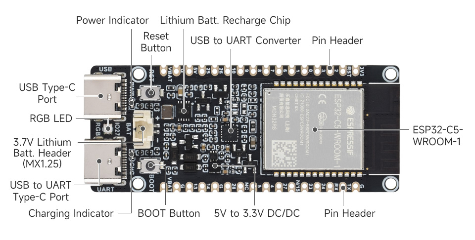
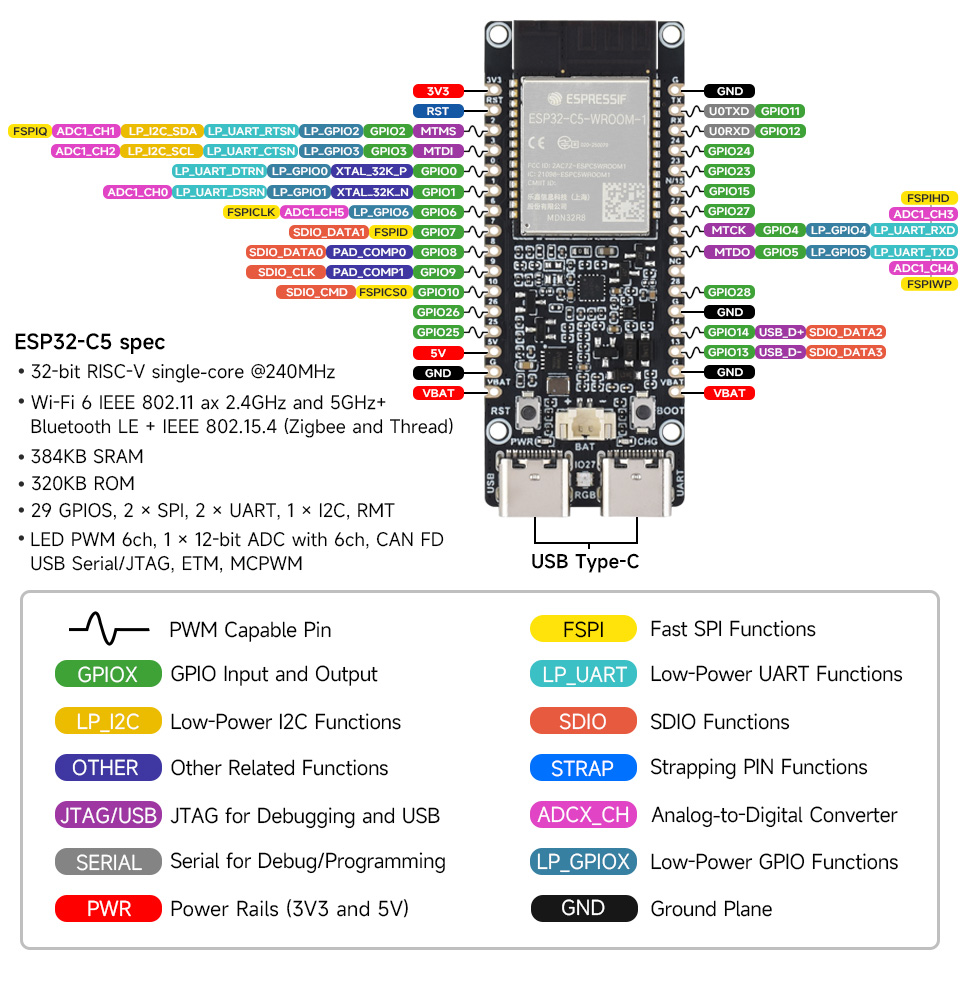
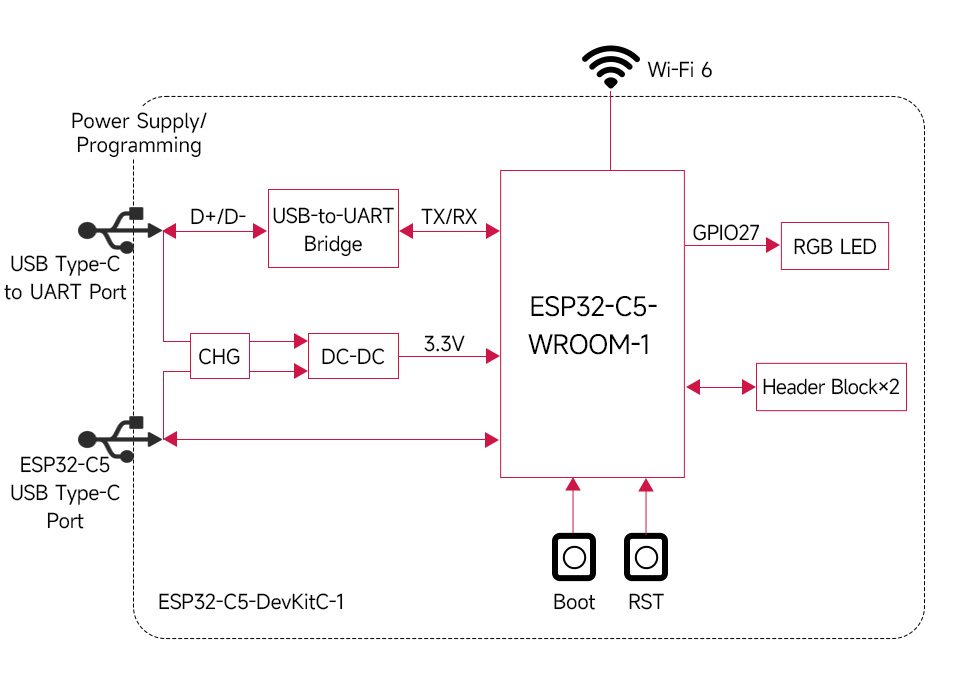

# esp32-c5

Projects with the dual-band 2.4G and 5G Wifi6 board single core RISC-V ESP32-C5

## Pin definition

- BOOT on GPIO28
- BAT_ADC over 200K/100K to GPIO6
- RGB LED on GPIO27 as WS2812B-0807
- Red LED when power 3.3 Volt
- Red LED when battery present with 3K resistor

## Reference repository

- [https://docs.waveshare.com/ESP32-C5-WIFI6-KIT](https://docs.waveshare.com/ESP32-C5-WIFI6-KIT)
- [Resources](https://docs.waveshare.com/ESP32-C5-WIFI6-KIT/Resources-And-Documents)
- [Schematic](https://files.waveshare.com/wiki/ESP32-C5-WIFI6-KIT-NXRX/ESP32-C5-WIFI6-KIT-NXRX-Schematic.pdf) ([local copy](docs/ESP32-C5-WIFI6-KIT-NXRX-Schematic.pdf))

## Images

## Features

- Utilizes the ESP32-C5-WROOM-1 series module, equipped with a RISC-V 32-bit processor running at up to 240MHz.
- Integrates 384KB SRAM, 320KB ROM, and 8MB PSRAM, with optional 16MB or 32MB Flash versions
- Integrates dual-band 2.4GHz & 5GHz Wi-Fi, Bluetooth 5 (LE), and IEEE 802.15.4 (supporting Zigbee 3.0 and Thread) wireless communication, delivering excellent RF performance.
- Onboard battery charging management module, with a reserved 3.7V MX1.25 lithium battery interface for external battery power supply.
- Features a reversible USB Type-C connector.
- Exposes rich peripheral interfaces with a castellated module design, facilitating soldering and integration onto user-designed carrier boards.
- Supports various low-power operating states, allowing flexible adjustment between communication range, data rate, and power consumption to meet the power requirements of various application scenarios.

## Power consumption

Will be added once I have my board. Both for USB and LiPo battery.

